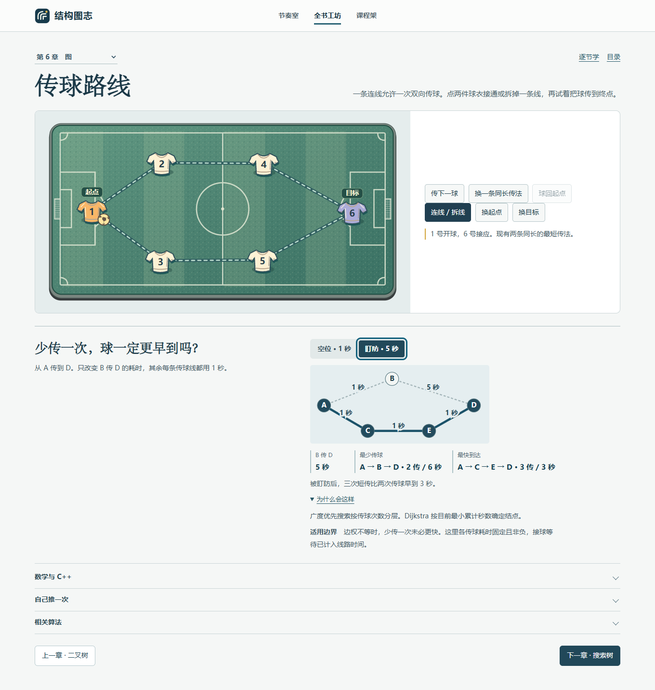

# 结构图志

用一段鼓点理解链表，用同一张球场图比较传球次数与到达时间，用可以修改的输入推演数据结构和算法。内容按邓俊辉《数据结构（C++语言版）》第 3 版正文的 **12 章、64 节** 编排。

**[下载离线交互版](https://github.com/shanec7825/structure-atlas/raw/refs/heads/main/index.html)**　·　**[直接在 GitHub 阅读全书](COURSE.md)**

把下载的文件保存为 `index.html`，用桌面或手机浏览器打开。声音、图片、代码和练习都在这一个文件里。浏览器会在本机保存录音和练习记录。

## 从哪里开始

- **第一次学指针**　在节奏室录四击，让原来的第二击最后响起。展开接线，核对哪些节点的 `next` 变了。第 3 章另有地址表，可以比较「只持有目标地址」和「另有前驱地址」两种情况。
- **跟课学习**　打开「全书目录」，输入节号或关键词，如 `6.9`、`KMP`、`红黑树`。每节都给出前提、具体状态变化和一道可独立核对的题；有「运行一遍」的节可以改输入、逐步执行。
- **考前自测**　从课程架进入「期末自测」。先写过程，再按参考解的得分点核对。需要复盘某一步时，可以跳回对应实验。



## 课程与实验

| 章节 | 内容举例 |
| --- | --- |
| 1–4　绪论、向量、列表、栈与队列 | 渐进复杂度与递归、扩容与指针失效、稳定链式归并、表达式与回溯 |
| 5–8　二叉树、图、搜索树、高级搜索树 | 哈夫曼树、遍历与双连通分量、最短路、AVL 删除、伸展树、B 树、红黑树和 kd 树 |
| 9–12　词典、优先级队列、串、排序 | 跳表与散列、建堆与左式堆、KMP、BM、滚动指纹、快速选择与希尔排序 |

64 节各有一道自测，另有 48 道分节补充练习。13 个分节演示接受自定义输入。课程架还收录 62 个逐步实验、827 个状态画面和 23 道带评分点的主观题。各章工坊和对照实验可从章节页进入。

## 构建与验证

使用 Node.js 22 或更新版本，在仓库根目录执行。构建和算法验证仅使用 Node.js 自带模块。

```sh
npm run build
npm test
```

构建生成离线成品 `index.html` 和逐节读本 `COURSE.md`。贡献内容时编辑 `src` 下的章节、图示或界面源码。

浏览器回归使用 Playwright，覆盖录音、章节跳转、用户输入、算法轨迹、离线加载和窄屏布局。

```sh
npm ci
npx playwright install chromium
npm run test:browser
```

Linux 环境如缺少系统库，可用 `npx playwright install --with-deps chromium`。已有 Chromium 时，也可用环境变量 `CHROMIUM_PATH` 指定可执行文件。浏览器测试截图写入本地 `artifacts/`。

## 教材依据

节号与正文范围据清华大学出版社第 3 版目录核对。本站的讲解、示例、可执行模型、图示和练习为独立编写的学习材料。节奏室鼓面使用生成图像，声音由浏览器合成。教材、勘误及配套课程可在作者网站查阅。[出版社目录](https://www.tup.tsinghua.edu.cn/bookscenter/bookcatalog?id=05358102) · [作者教材页](https://dsa.cs.tsinghua.edu.cn/~deng/ds/dsacpp/)
